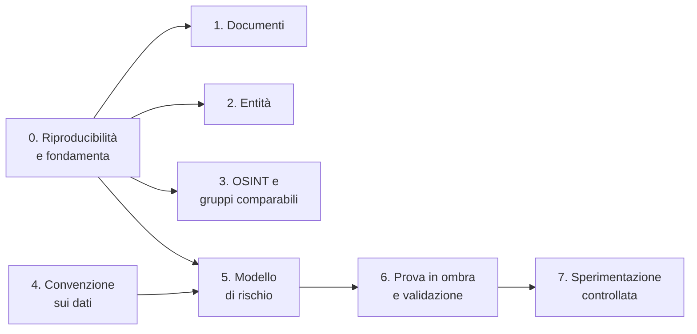
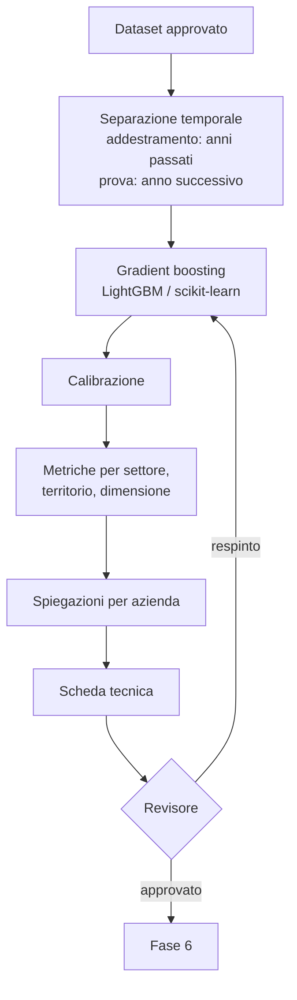

# K. Roadmap per l'integrazione dell'intelligenza artificiale

> **Collegato a:** [`J_INTELLIGENZA_ARTIFICIALE.md`](J_INTELLIGENZA_ARTIFICIALE.md) (valutazione, principi, priorità)
> **Stato:** pianificazione. Nessuna fase è ancora avviata.
> Ogni fase si chiude con un **criterio di uscita verificabile**; senza di esso non si passa alla successiva.
> Le soglie numeriche sono **obiettivi proposti**, da confermare sull'insieme di prova con stima dell'incertezza. Le durate sono indicative.

---

## Sintesi

| Fase | Contenuto | Dati riservati? | Durata indicativa |
|---|---|---|---|
| 0 | Riproducibilità e fondamenta comuni per le funzioni IA | no | 4–6 settimane |
| 1 | Lettura assistita dei documenti | no | 6–8 settimane |
| 2 | Riconoscimento delle entità | no, salvo record forniti da enti | 6–8 settimane |
| 3 | Classificazione OSINT e gruppi comparabili | no | circa 6 settimane |
| 4 | Convenzione sui dati ed etichette | **sì** | 3–6 mesi (amministrativa) |
| 5 | Modello supervisionato di rischio | **sì** | circa 3 mesi |
| 6 | Prova in ombra e validazione indipendente | **sì** | 6–12 mesi |
| 7 | Sperimentazione controllata | **sì** | secondo il piano dell'ente |

Le fasi 1–3 sono indipendenti tra loro e possono procedere in parallelo alla fase 4. L'esito negativo di una di esse non obbliga a proseguire con le altre.

---

## Fase 0 — Riproducibilità e fondamenta comuni

**Obiettivo:** non aggiungere complessità sopra una base non riproducibile, e governare ogni funzione IA con le stesse garanzie dei coefficienti.

**Riproducibilità**
- [ ] Installazione in ambiente pulito con le versioni bloccate; suite completa e controllo delle vulnerabilità (`pip-audit`), come indicato in [`VERIFICHE.md`](VERIFICHE.md).
- [ ] Regressione dei risultati a regole invariata (impronta `cb82abaf…19bf`).

**Fondamenta**
- [ ] **Registro delle funzioni IA** (nuova migrazione in `app/db_operativo.py`): identificativo, tipo, versione, impronta del modello e degli artefatti, versione del codice e dell'ambiente di esecuzione, provenienza dei dati, metriche, scheda tecnica, stato.
- [ ] **Contratti distinti per tipo di funzione**, nell'elenco chiuso di `app/moduli_settore.py`:

| Tipo | Ingresso | Uscita |
|---|---|---|
| `estrazione_documentale` | documento registrato | proposte con documento, pagina, estratto, tabella o riga |
| `riconoscimento_entita` | coppie di record | esito (probabile / da verificare / differenti), evidenze |
| `classificazione_osint` | pagina acquisita | classe, sintesi con citazioni |
| `modello_rischio` | record aziendale analizzato | punteggio separato, spiegazione, versione |

- [ ] Ciclo di vita uguale a quello dei settori (`app/ciclo_settori.py`): bozza → collaudo → revisione → sperimentazione → approvazione.
- [ ] **Modalità in ombra:** risultati calcolati e registrati, non mostrati agli operatori.
- [ ] **Non interferenza:** errore, timeout o assenza del modello non alterano il motore a regole; risultato in un campo separato.
- [ ] **Disattivazione** e ritorno alla situazione precedente senza perdita dello storico.
- [ ] Collaudo automatico esteso: riproducibilità, dati mancanti, valori fuori intervallo, non interferenza.

**Criterio di uscita:** installazione pulita superata; una funzione dimostrativa per ciascun contratto percorre l'intero ciclo; risultati a regole identici.

---

## Fase 1 — Lettura assistita dei documenti

**Obiettivo:** proporre valori, unità, periodi e riferimenti estratti da decreti, contratti collettivi e capitolati, anche scansionati.

| Elemento | Opzione da provare | Motivo |
|---|---|---|
| OCR | Tesseract (italiano) | gratuito, locale |
| Tabelle da PDF testuali | pdfplumber | gratuito, conserva le posizioni |
| Modello linguistico | modello open source in locale (llama.cpp o Ollama) | nessun dato verso l'esterno |

Sono opzioni da provare su documenti rappresentativi, non componenti già installate.

- [ ] Ogni proposta riporta documento, pagina, estratto originale e, se disponibile, tabella o riga; **senza evidenza valida viene scartata**.
- [ ] Ingresso nel flusso esistente: proposta → revisore → nuova versione del parametro "da verificare".
- [ ] Insieme di prova: almeno 30 documenti pubblici (es. D.M. 143/2021, contratti collettivi) con valori trascritti a mano, separati tra PDF testuali e scansionati, tabelle semplici e complesse.

**Criterio di uscita (obiettivo proposto):** almeno il 95% dei valori proposti corrisponde al documento; nessun errore critico non intercettato dalla revisione.

---

## Fase 2 — Riconoscimento delle entità

**Obiettivo:** riconoscere la stessa impresa o persona tra fonti diverse.

- [ ] Record linkage probabilistico (es. Splink) su codice fiscale o partita IVA, denominazione normalizzata, sede, date, ove disponibili e utilizzabili per la finalità.
- [ ] Tre esiti: **corrispondenza probabile**, **da verificare**, **record differenti**. Il nome da solo non basta mai.
- [ ] I risultati sono candidati per il grafo: registrazione solo dopo revisione documentale.
- [ ] Campione di 500 coppie verificate a mano, analizzato per sottogruppi (identificativi affidabili, dati incompleti, denominazioni comuni).

**Criterio di uscita (obiettivo proposto):** precisione ≥ 99% sulla classe "corrispondenza probabile", con richiamo e falsi abbinamenti riportati.

---

## Fase 3 — Classificazione OSINT e gruppi comparabili

**OSINT**
- [ ] Verificare prima che il flusso di acquisizione copra le fonti necessarie.
- [ ] Classificatore di pertinenza (annuncio di lavoro, notizia su un'impresa, non pertinente) su 1.000–2.000 pagine annotate a mano.
- [ ] Sintesi solo con citazione delle frasi di origine; nessuna valutazione di veridicità.

**Gruppi comparabili**
- [ ] Clustering per attività, dimensione, territorio e stagionalità, con variabili ed esclusioni motivate.
- [ ] Uso solo per gruppi stabili tra esecuzioni e di dimensione adeguata (minimo 10 aziende, regola già presente, ma non sufficiente da sola).

**Criterio di uscita (obiettivo proposto):** precisione ≥ 90% sulla classe "pertinente", contenuti rilevanti mancati misurati; gruppi stabili.

---

## Fase 4 — Convenzione sui dati ed etichette

**Obiettivo:** ottenere in modo lecito i dati necessari al modello di rischio. Le strade possibili sono descritte in [`L_PROSPETTIVE_E_COLLABORAZIONI.md`](L_PROSPETTIVE_E_COLLABORAZIONI.md).

- [ ] Convenzione con l'ente: finalità, base giuridica, titolarità, conservazione, accessi.
- [ ] Valutazione d'impatto e parere del DPO; valutazione della classificazione secondo l'AI Act da parte di soggetti competenti.
- [ ] Dati dichiarativi ed esiti dei controlli conclusi su più anni, inclusi i casi senza irregolarità.
- [ ] **Campione di controlli casuali** o misure equivalenti contro la distorsione di selezione.
- [ ] Dizionario dei dati e definizione scritta di "irregolarità accertata".

**Criterio di uscita:** dataset approvato e documentato. Il numero di casi irregolari per settore (indicativamente alcune centinaia) va valutato insieme a casi negativi, copertura, squilibrio tra classi e precisione richiesta: nessuna soglia è sufficiente da sola.

---

## Fase 5 — Modello supervisionato di rischio

- [ ] Variabili: grandezze già calcolate dal motore (scarti, costo per addetto, incidenza, robustezza) e dati dichiarativi. **Nessuna variabile su nazionalità, genere o altre caratteristiche personali.**
- [ ] Vincoli di monotonia dove hanno senso logico.
- [ ] Separazione temporale, mai casuale; nessuna mescolanza di osservazioni correlate.
- [ ] Calibrazione, se si mostrano probabilità.
- [ ] Metriche con intervalli di confidenza per gruppo (`app/motore/valutazione.py` già le calcola).
- [ ] Confronto con il motore a regole sulle stesse etichette.
- [ ] Scheda tecnica: dati, periodo, popolazione, prestazioni, limiti, usi non ammessi.

**Criterio di uscita:** miglioramento statisticamente significativo rispetto alle regole; nessun gruppo con un tasso di falsi positivi significativamente più alto degli altri.

---

## Fase 6 — Prova in ombra e validazione indipendente

- [ ] Esecuzione in ombra per 6–12 mesi, con popolazione, metrica principale, soglie e criteri di arresto definiti **prima** dell'avvio.
- [ ] Confronto finale con gli esiti dei controlli svolti nel periodo.
- [ ] Validazione da un soggetto che non ha sviluppato il modello, con accesso a codice, dati, esecuzioni e audit.
- [ ] Revisione di sicurezza: avvelenamento dei dati, manipolazione degli input, fuga di informazioni.

**Criterio di uscita:** relazione di validazione positiva e approvazione formale dell'ente.

---

## Fase 7 — Sperimentazione controllata

- [ ] Punteggio del modello visibile agli operatori, accanto a quello a regole, con spiegazione.
- [ ] Formazione degli operatori sull'interpretazione dei risultati.
- [ ] Monitoraggio continuo di prestazioni e deriva dei dati.
- [ ] Riaddestramento solo come nuova versione, con nuovo collaudo e nuova approvazione.
- [ ] Criteri di interruzione definiti in [`F_PIANO_SPERIMENTAZIONE.md`](F_PIANO_SPERIMENTAZIONE.md).

---

## Integrazione nel codice

| Componente | Modifica prevista |
|---|---|
| `app/db_operativo.py` | migrazione: registro delle funzioni IA, risultati in ombra |
| `app/moduli_settore.py` | contratti distinti per tipo di funzione, elenco chiuso |
| `app/ciclo_settori.py`, `app/collaudo_settori.py` | ciclo di vita e collaudo estesi alle funzioni IA |
| `app/motore/analisi.py` | risultato del modello di rischio in un campo separato `analisi.modello` |
| `app/motore/valutazione.py` | confronto regole/modello sulle stesse etichette |
| `app/estrazione_documenti.py`, `app/collegamento_semantico.py` | proposte dalla lettura assistita (fase 1) |
| `app/grafo.py` | candidati dal riconoscimento delle entità (fase 2) |
| `app/osint_esteso.py` | pertinenza e sintesi (fase 3) |
| `app/report.py`, scheda azienda | sezione "risultato del modello" con spiegazione e versione |
| `docs/` | scheda tecnica di ogni funzione approvata |

**Regole:**
- File dei modelli, dataset autorizzati, dati personali e credenziali **non** vanno nel repository; i modelli sono custoditi dall'ente e verificati tramite impronta.
- Il caricamento di un modello non esegue codice arbitrario: formati e procedure scelti dopo revisione di sicurezza (es. ONNX o formati nativi privi di esecuzione di codice; mai `pickle` da fonti non controllate).
- Esecuzione locale; verificare che log, telemetria, download e aggiornamenti non trasferiscano dati all'esterno.

---

## Strumenti candidati (open source)

| Ambito | Strumento |
|---|---|
| Modello di rischio | scikit-learn, LightGBM |
| Spiegazioni | SHAP |
| Riconoscimento delle entità | Splink |
| OCR | Tesseract |
| Tabelle da PDF | pdfplumber |
| Modello linguistico locale | llama.cpp o Ollama con un modello open source |
| Formato dei modelli | ONNX o formati nativi senza esecuzione di codice |

I costi principali non sono le licenze: sono il tempo di annotazione dei dati, l'infrastruttura dell'ente e la validazione indipendente.

---

## Rischi e mitigazioni

| Rischio | Mitigazione |
|---|---|
| Distorsione di selezione nelle etichette | controlli casuali, analisi della popolazione (fase 4) |
| Penalizzazione di gruppi di imprese | metriche per gruppo, criteri di interruzione |
| Opacità | spiegazioni per risultato, affiancamento alle regole |
| Deriva nel tempo | monitoraggio, riaddestramento versionato |
| Uso del risultato come prova | avvisi in interfaccia e nella relazione, formazione |
| Contenuti inventati dal modello linguistico | proposte valide solo con citazione verificabile, revisione umana |
| Falsi abbinamenti nel grafo | classe "da verificare", revisione documentale obbligatoria |
| Fuga di dati | esecuzione locale, controllo di log e telemetria |
