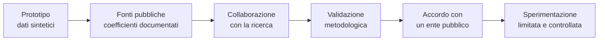

# L. Prospettive e collaborazioni

> Questo documento non descrive una funzione del software. Descrive **ciò che il codice da solo non può fornire** e le strade che possono portare Emersione dalla dimostrazione all'uso reale.

---

## 1. Il limite che il codice non supera

Emersione è un prototipo completo: motore a regole spiegabile, registro dei settori con ciclo di approvazione, collaudo automatico, audit verificabile, relazioni con impronta, suite di test automatici. Funziona però su **dati sintetici**, e i suoi coefficienti sono in gran parte **ipotesi da verificare**, come dichiarato in [`H_LIMITI_NOTI.md`](H_LIMITI_NOTI.md).

È una condizione di partenza, non un difetto tecnico. Uno strumento di analisi del rischio diventa utile solo quando può rispondere a una domanda:

> *Quando Emersione segnala un'azienda, con quale frequenza la segnalazione è fondata? E con quale frequenza segnala chi è in regola?*

Per rispondere servono tre elementi che non si possono generare al computer:

1. **Dati reali** sulle imprese: addetti dichiarati, ore, costo del lavoro, produzione.
2. **Esiti di controlli conclusi**, per sapere quali segnalazioni erano fondate.
3. **Competenze indipendenti** che validino metodologia, coefficienti, sicurezza e conformità normativa.

Lo stesso vale, a maggior ragione, per l'eventuale integrazione di funzioni di intelligenza artificiale ([`J_INTELLIGENZA_ARTIFICIALE.md`](J_INTELLIGENZA_ARTIFICIALE.md)): un modello addestrato senza esiti reali riproduce soltanto le regole che gli vengono fornite.

---

## 2. Tre livelli di accesso ai dati

### 2.1 Dati pubblici: utilizzabili da subito

| Fonte | Utilità per Emersione |
|---|---|
| Open data ANAC (formato OCDS) | appalti, aggiudicatari, relazioni tra imprese |
| Dati aggregati ISTAT | ore lavorate, occupati e valore aggiunto per settore e territorio, a sostegno dei coefficienti |
| Rapporti annuali sull'attività di vigilanza | ordini di grandezza dell'irregolarità per settore e area, per tarare le soglie |
| Normativa e contratti collettivi | parametri con fonte citata, prove per la lettura assistita dei documenti |

Con queste fonti possono procedere le attività che non richiedono dati riservati: revisione dei coefficienti e fasi 1–3 di [`K_ROADMAP_IA.md`](K_ROADMAP_IA.md).

### 2.2 Dati individuali per la ricerca: tramite un'istituzione

In Italia esistono canali strutturati per l'accesso a dati elementari a fini di ricerca, tra cui:

- il **Laboratorio ADELE dell'ISTAT**, riservato a ricercatori di enti riconosciuti, con controllo della riservatezza sui risultati;
- il programma **VisitINPS Scholars**, che consente a ricercatori di università italiane e straniere di lavorare su dati amministrativi in ambienti protetti.

Sono percorsi pensati per la ricerca scientifica, non per singoli sviluppatori: un progetto come questo può accedervi solo **all'interno di un gruppo di ricerca** che ne riconosca l'interesse scientifico, e nel rispetto delle regole di ciascun programma.

### 2.3 Esiti delle ispezioni: tramite un ente pubblico

Le informazioni su quali controlli hanno accertato irregolarità sono, giustamente, nella disponibilità delle autorità competenti. L'accesso è possibile solo con **accordi formali**, base giuridica, valutazione d'impatto e garanzie per le persone coinvolte.

Le amministrazioni stanno lavorando nella stessa direzione: il **Portale nazionale del sommerso**, affidato all'Ispettorato Nazionale del Lavoro, è pensato per riunire le informazioni di più enti su ispezioni e violazioni; le cronache ne hanno riportato ritardi di attuazione.

In questo quadro Emersione non si propone come alternativa agli strumenti pubblici, ma come **possibile strato di analisi spiegabile e verificabile**, da valutare sopra dati che già esistono e sotto il controllo dell'ente che ne è titolare.

---

## 3. Competenze necessarie

| Area | Competenza |
|---|---|
| Metodologia | economia del lavoro, statistica applicata, conoscenza dei settori (agricoltura, edilizia, logistica, ristorazione) |
| Coefficienti | fonti tecniche e normative, esperienza ispettiva |
| Sicurezza | revisione del codice, test di penetrazione |
| Diritto | protezione dei dati, valutazione d'impatto, classificazione secondo il Regolamento (UE) 2024/1689 |
| Accessibilità | verifica con utenti e tecnologie assistive |
| Sperimentazione | un ente disposto a una prova limitata e controllata ([`F_PIANO_SPERIMENTAZIONE.md`](F_PIANO_SPERIMENTAZIONE.md)) |

Nessuna di queste competenze si sostituisce con il codice; tutte possono contribuire a un progetto aperto.

---

## 4. Un percorso possibile

1. **Fonti pubbliche:** sostituire le ipotesi con valori documentati, dove esistono.
2. **Ricerca:** definire con un gruppo universitario un progetto scientifico che dia accesso ai canali previsti.
3. **Validazione:** misurare precisione e falsi positivi per settore, territorio e dimensione, con le relative incertezze.
4. **Ente pubblico:** proporre una sperimentazione circoscritta (una provincia o un settore) con tutte le garanzie previste.
5. **Sperimentazione:** il sistema affianca il lavoro umano senza sostituirlo, con criteri di interruzione definiti in anticipo.

Ogni passo è subordinato all'esito del precedente: se la validazione non mostra un'utilità misurabile, il percorso si ferma.

---

## 5. Perché il progetto è aperto

Uno strumento che riguarda il lavoro, le imprese e i diritti delle persone deve poter essere **letto, criticato e verificato**. In Emersione ogni formula è dichiarata, ogni coefficiente ha uno stato e una fonte, ogni esecuzione lascia una traccia verificabile e ogni limite noto è scritto.

L'apertura ha anche un'altra funzione: rendere possibile l'incontro tra chi ha scritto il codice e chi dispone di ciò che al codice manca.

---

## 6. Se il progetto riguarda il tuo lavoro

Alcuni lettori potrebbero riconoscersi in una di queste situazioni:

- svolgi **ricerca** su lavoro, economia sommersa, statistica pubblica o intelligenza artificiale responsabile e cerchi un caso di studio concreto e già strutturato;
- lavori in un'**amministrazione** che si occupa di vigilanza, appalti o politiche del lavoro e ti interessa capire come rendere più trasparenti gli strumenti di analisi del rischio;
- hai **esperienza ispettiva o di settore** e sai quali indicatori contano davvero e quali ingannano;
- ti occupi di **sicurezza informatica, protezione dei dati o diritto delle tecnologie** e vuoi mettere alla prova un sistema progettato per essere verificabile;
- sei uno **sviluppatore** interessato al software pubblico, aperto e riutilizzabile.

Una **issue** o una **discussione** in questo repository è il modo più semplice per avviare un confronto: una critica alla metodologia, l'indicazione di una fonte, una verifica indipendente, una proposta di sperimentazione o una semplice domanda.

Ogni contributo viene valutato con le regole del progetto: trasparenza, verificabilità e rispetto delle persone coinvolte. **Non inviare mai dati personali o riservati nelle issue**: per argomenti che li richiedono, è preferibile chiedere prima un canale adeguato.

---

## Fonti

- [ISTAT, Laboratorio ADELE](https://www.istat.it/dati/microdati/laboratorio-adele/)
- [INPS, Programma VisitINPS Scholars](https://inps.it/it/it/dati-e-bilanci/attivit--di-ricerca/programma-visitinps-scholars.html)
- [QuiFinanza, Il Portale nazionale del sommerso](https://quifinanza.it/lavoro/diritto-del-lavoro/nuovo-portale-lavoro-nero-guida/867229/)
- [L'Espresso, Lavoro nero: la riforma digitale resta sulla carta (agosto 2025)](https://lespresso.it/c/politica/2025/8/7/lavoro-nero-riforma-digitale-resta-sulla-carta/56116)
- [ANAC su Open Contracting Partnership](https://data.open-contracting.org/en/publication/117)

## Documenti correlati

- [`A_PRESENTAZIONE.md`](A_PRESENTAZIONE.md) — il progetto in sintesi
- [`F_PIANO_SPERIMENTAZIONE.md`](F_PIANO_SPERIMENTAZIONE.md) — come provarlo in modo controllato
- [`H_LIMITI_NOTI.md`](H_LIMITI_NOTI.md) — limiti dichiarati
- [`J_INTELLIGENZA_ARTIFICIALE.md`](J_INTELLIGENZA_ARTIFICIALE.md) — valutazione sull'intelligenza artificiale
- [`K_ROADMAP_IA.md`](K_ROADMAP_IA.md) — fasi di realizzazione
